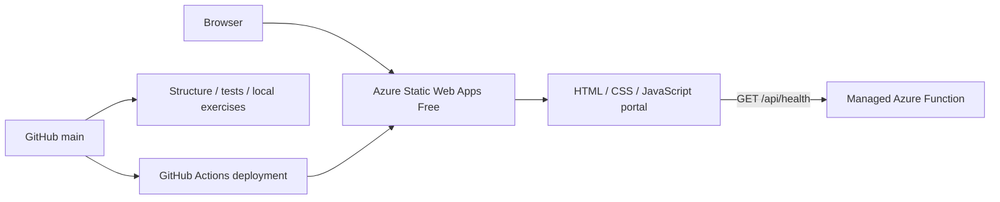

# Azure Customer Success Journey

> **Completed portfolio lab · 14 October 2026:** Azure Static Web Apps Free deployed, public portal and managed API verified, local failure/recovery exercises executed, mock customer communications and value review completed. CloudShop is fictional; independent customer adoption and commercial outcomes are not measured.

A portfolio lab by Luca Puckaß connecting four years of technical customer support with Azure fundamentals and customer success. Luca completed the Azure portal setup with guidance; Codex assisted with implementation, automated checks and documentation. This is a learning project, not professional Azure administration or an employer engagement.

**[Open the live demo](https://purple-meadow-08a08f610.3.azurestaticapps.net/)** · [Live API](https://purple-meadow-08a08f610.3.azurestaticapps.net/api/health) · [Evidence register](docs/customer-success/evidence-register.md) · [German walkthrough](docs/customer-success/project-walkthrough-de.md)

## The customer problem

CloudShop is a fictional e-commerce support team with scattered instructions and repeated status questions. The pilot provides one shared status/information portal. Orders, payments, a real customer database and production shop migration are outside scope.

| Success criterion | Evidence and result |
|---|---|
| Verify deployed portal and endpoint | Live HTTP 200 checks, runtime response and headers; E02/E03 |
| Recover from a controlled incident and communicate | Local injected HTTP 503/403 and failed validation, recovery records, German role-play updates; E05/E06 |
| Complete status, runbook and escalation walkthrough | Assistant functional walkthrough; independent learner test remains open; E07 |

## Completed deliverables

- [Customer brief](docs/customer-success/customer-brief.md): goals, owners and boundaries.
- [Success plan](docs/customer-success/success-plan.md): proposed 30/60/90-day phases, not elapsed customer history.
- [Health model](docs/customer-success/health-model.md): partial lab evidence and an explicitly synthetic 57.5/100 example; no current overall score.
- [Customer communication](docs/customer-success/customer-communications.md): initial update, technical handoff and closure, all role-play.
- [Onboarding record](docs/customer-success/onboarding-record.md): functional walkthrough and independent acceptance tasks.
- [Value review](docs/customer-success/value-review.md): results, unknowns and evidence-based next action.
- [Incident reports](docs/troubleshooting-runbook.md): local experiments, not manufactured Azure outages.
- [Evidence](docs/evidence/): timestamped machine-readable HTTP and exercise results.

## Architecture



The health endpoint checks its own runtime. It does not check a shop, database, adoption or customer satisfaction. The Free plan is appropriate for this small learning pilot, not a promise of a production SLA.

The cloud region for managed regional features is Central US as selected in the actual portal deployment; static assets are globally distributed. The resource group name ends in `weu` but its name does not determine the app's region. No real customer data is stored.

## Verification

```bash
npm run validate
npm test
npm run exercise
npm run verify:live
cd api
npm ci
npm test
```

`exercise` uses only loopback servers and a disposable local validation fixture. It creates timestamped evidence; repeating it changes the latest record. It does not modify Azure IAM or break the live demo. `verify:live` reads the public URL and records point-in-time responses.

For a browser demo, run `npm run preview` at the repository root. The local API is labelled simulated. Set `LAB_HEALTH_MODE=unavailable` or `access-denied` for the local-only error exercise. See [German walkthrough](docs/customer-success/project-walkthrough-de.md).

## Costs and operational limits

- Actual Azure resource: Static Web Apps **Free**, with managed API.
- EUR 1 monthly subscription budget created. An alert is not a spending cap.
- Initial October 2026 billing view: **No cost reported**; Actual cost and Forecast show `--`, not a measured EUR 0 invoice.
- No VM, paid database, Front Door or Application Insights added.
- Continuous monitoring is not enabled. The current approach uses manual checks and deployment logs.
- Repeat cost analysis after usage data arrives. Do not claim recurring zero cost or ROI from this initial view.

## Learning-project boundaries

The Azure deployment is real. HTTP 503/403 faults and validation failure were deliberately injected locally and verified by Codex. The access-denied exercise is **not** an Azure RBAC change. Customer messages are written role-play, not sent. The walkthrough is an assistant check, not proof that Luca or a customer can complete the tasks unaided.

The Bicep template is provided as an optional reproducible definition and has not been deployed. An independent onboarding test, real customer engagement, quantified time savings and long-term uptime remain unmeasured. These are follow-up evidence, not fabricated results.

## Interview demonstration

Open the portal, run a technical check, explain why customer health remains unknown, show one local incident report, and finish with the [value review](docs/customer-success/value-review.md). A guided explanation of every step is in the [German walkthrough](docs/customer-success/project-walkthrough-de.md).
